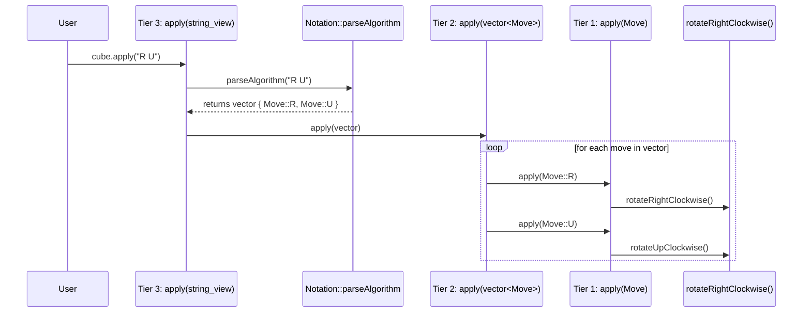

# Rubik's Cube Code & Domain Logic — Learning Notes

## 1. Architecture & Codebase Layout

### The 5 Modular Layers
```text
 [ User / Command-Line Interface (main.cpp) ]
                     │
                     ▼
 [ Notation & Scramble Layer (Notation.hpp / Scrambler.hpp) ]
   - Parses inputs like "R U R' U'"
   - Generates random 20-move scrambles
                     │
                     ▼
 [ Core Cube Model (Cube.hpp / Cube.cpp) ]
   - 54-sticker flat array representation
   - Face turns (U, D, F, B, L, R and inverses)
   - Solved-state detection (isSolved())
                     ▲
                     │ (queries state & branches moves)
                     ▼
 [ Solver Engine (Solver.hpp / Solver.cpp) ]
   - Search Algorithms (BFS, IDDFS, or Two-Phase / Kociemba)
   - Finds solution sequences to restore solved state
```

### Directory Responsibilities
- `include/`: Header files (`.hpp`) containing types, constants, and function declarations. Separates *interface* from *implementation*.
- `src/`: Source files (`.cpp`) implementing the classes and main program.
- `tests/`: Automated unit tests verifying domain logic.
- `docs/`: Technical specifications, design notes, and learning logs.
- `build/`: Out-of-source compilation artifacts (git-ignored).

---

## 2. Cube Representation & Data Structures

### Scoped Enumeration (`enum class Color`)
```cpp
enum class Color { White, Yellow, Red, Orange, Blue, Green };
```
- `enum class` provides strong type safety (cannot be implicitly converted to integers).

### Fixed-Size Array (`std::array`)
```cpp
static constexpr std::size_t FaceCount = 6;
static constexpr std::size_t StickersPerFace = 9;
static constexpr std::size_t StickerCount = FaceCount * StickersPerFace; // 54

std::array<Color, StickerCount> stickers;
```
- **Flat array advantage**: Cache-friendly, contiguous memory, fixed size, minimal copying overhead during high-speed tree search.

### Face Ordering and Index Ranges
| Face Index | Face Name | Notation | Default Color | Index Range |
| :---: | :---: | :---: | :---: | :---: |
| **0** | Up | **U** | White | 0 – 8 |
| **1** | Down | **D** | Yellow | 9 – 17 |
| **2** | Front | **F** | Red | 18 – 26 |
| **3** | Back | **B** | Orange | 27 – 35 |
| **4** | Left | **L** | Blue | 36 – 44 |
| **5** | Right | **R** | Green | 45 – 53 |

---

## 3. Coordinate & Indexing Mathematics

### 2D Unfolded Net View
```text
                     +------------+
                     |  UP (0)    |
                     |  0   1   2 |
                     |  3   4   5 |
                     |  6   7   8 |
      +------------+ +------------+ +------------+ +------------+
      |  LEFT (4)  | | FRONT (2)  | | RIGHT (5)  | |  BACK (3)  |
      | 36  37  38 | | 18  19  20 | | 45  46  47 | | 27  28  29 |
      | 39  40  41 | | 21  22  23 | | 48  49  50 | | 30  31  32 |
      | 42  43  44 | | 24  25  26 | | 51  52  53 | | 33  34  35 |
      +------------+ +------------+ +------------+ +------------+
                     |  DOWN (1)  |
                     |  9  10  11 |
                     | 12  13  14 |
                     | 15  16  17 |
                     +------------+
```

### Formula for Sticker Indices
For any given `face` ($0 \le \text{face} < 6$), `row` ($0 \le \text{row} < 3$), and `col` ($0 \le \text{col} < 3$):
- **Local Face Offset**: $\text{localIndex} = \text{row} \times 3 + \text{col}$
- **Global Index**: $\text{globalIndex} = (\text{face} \times 9) + (\text{row} \times 3) + \text{col}$

---

## 4. Cube Rotations — The Front Clockwise Move ($F$)

A physical face rotation consists of **two distinct operations**:
1. Rotating the 9 stickers on the face itself by $90^\circ$ clockwise.
2. Cycling the 12 stickers on the adjacent rim faces.

### Operation 1: 3×3 Face Grid Rotation
Formula mapping clockwise: $(r, c) \to (c, 2 - r)$

```text
Old 3x3 Grid:       Rotated Clockwise:
0  1  2             6  3  0
3  4  5    ───>     7  4  1
6  7  8             8  5  2
```

In code (`rotateFaceClockwise(std::size_t face)`):
```cpp
const std::size_t start = face * StickersPerFace;
const auto old = stickers;

for (std::size_t row = 0; row < 3; ++row) {
    for (std::size_t col = 0; col < 3; ++col) {
        const std::size_t oldIndex = start + row * 3 + col;
        const std::size_t newIndex = start + col * 3 + (2 - row);
        stickers[newIndex] = old[oldIndex];
    }
}
```
*Notice: The center sticker at offset 4 ($r=1, c=1$) maps to $(1, 2-1) = 4$, remaining stationary.*

### Operation 2: Adjacent Rim Permutations for $F$ Turn (Front)
When the Front face turns clockwise, the bordering rows/columns on adjacent faces shift in a 4-cycle:
- **Up (`U`) bottom row** $\to$ **Right (`R`) left column**:
  - `stickers[45] = old[6]`
  - `stickers[48] = old[7]`
  - `stickers[51] = old[8]`
- **Right (`R`) left column** $\to$ **Down (`D`) top row**:
  - `stickers[9]  = old[45]`
  - `stickers[10] = old[48]`
  - `stickers[11] = old[51]`
- **Down (`D`) top row** $\to$ **Left (`L`) right column**:
  - `stickers[38] = old[9]`
  - `stickers[41] = old[10]`
  - `stickers[44] = old[11]`
- **Left (`L`) right column** $\to$ **Up (`U`) bottom row**:
  - `stickers[6] = old[44]`
  - `stickers[7] = old[41]`
  - `stickers[8] = old[38]`

### Operation 3: Adjacent Rim Permutations for $U$ Turn (Up)
When looking down at the Up face, a clockwise turn shifts the top row (row 0) across all 4 surrounding faces in order:
- **Front (`F`) top row** $\to$ **Left (`L`) top row**:
  - `stickers[36] = old[18]`
  - `stickers[37] = old[19]`
  - `stickers[38] = old[20]`
- **Left (`L`) top row** $\to$ **Back (`B`) top row**:
  - `stickers[27] = old[36]`
  - `stickers[28] = old[37]`
  - `stickers[29] = old[38]`
- **Back (`B`) top row** $\to$ **Right (`R`) top row**:
  - `stickers[45] = old[27]`
  - `stickers[46] = old[28]`
  - `stickers[47] = old[29]`
- **Right (`R`) top row** $\to$ **Front (`F`) top row**:
  - `stickers[18] = old[45]`
  - `stickers[19] = old[46]`
  - `stickers[20] = old[47]`

### Operation 4: Adjacent Rim Permutations for $R$ Turn (Right)
When looking at the Right face, turning it clockwise rotates columns on the 4 bordering faces:
- **Front (`F`) right column** $\to$ **Up (`U`) right column**:
  - `stickers[2] = old[20]`
  - `stickers[5] = old[23]`
  - `stickers[8] = old[26]`
- **Up (`U`) right column** $\to$ **Back (`B`) left column (inverted)**:
  - `stickers[27] = old[8]`
  - `stickers[30] = old[5]`
  - `stickers[33] = old[2]`
- **Back (`B`) left column** $\to$ **Down (`D`) right column (inverted)**:
  - `stickers[11] = old[33]`
  - `stickers[14] = old[30]`
  - `stickers[17] = old[27]`
- **Down (`D`) right column** $\to$ **Front (`F`) right column**:
  - `stickers[20] = old[11]`
  - `stickers[23] = old[14]`
  - `stickers[26] = old[17]`

### Operation 5: Adjacent Rim Permutations for $L$ Turn (Left)
When looking at the Left face, turning it clockwise shifts vertical columns on the 4 bordering faces:
- **Up (`U`) left column** $\to$ **Front (`F`) left column**:
  - `stickers[18] = old[0]`
  - `stickers[21] = old[3]`
  - `stickers[24] = old[6]`
- **Front (`F`) left column** $\to$ **Down (`D`) left column**:
  - `stickers[9]  = old[18]`
  - `stickers[12] = old[21]`
  - `stickers[15] = old[24]`
- **Down (`D`) left column** $\to$ **Back (`B`) right column (inverted)**:
  - `stickers[29] = old[15]`
  - `stickers[32] = old[12]`
  - `stickers[35] = old[9]`
- **Back (`B`) right column** $\to$ **Up (`U`) left column (inverted)**:
  - `stickers[0]  = old[35]`
  - `stickers[3]  = old[32]`
  - `stickers[6]  = old[29]`

### Operation 6: Adjacent Rim Permutations for $D$ Turn (Down)
When looking at the Down face, turning it clockwise shifts the bottom row (row 2) across the 4 bordering faces:
- **Left (`L`) bottom row** $\to$ **Back (`B`) bottom row**:
  - `stickers[33] = old[42]`
  - `stickers[34] = old[43]`
  - `stickers[35] = old[44]`
- **Back (`B`) bottom row** $\to$ **Right (`R`) bottom row**:
  - `stickers[51] = old[33]`
  - `stickers[52] = old[34]`
  - `stickers[53] = old[35]`
- **Right (`R`) bottom row** $\to$ **Front (`F`) bottom row**:
  - `stickers[24] = old[51]`
  - `stickers[25] = old[52]`
  - `stickers[26] = old[53]`
- **Front (`F`) bottom row** $\to$ **Left (`L`) bottom row**:
  - `stickers[42] = old[24]`
  - `stickers[43] = old[25]`
  - `stickers[44] = old[26]`

### Operation 7: Adjacent Rim Permutations for $B$ Turn (Back)
When looking at the Back face, turning it clockwise shifts bordering rows/columns across 4 faces:
- **Right (`R`) right column** $\to$ **Up (`U`) top row**:
  - `stickers[0] = old[47]`
  - `stickers[1] = old[50]`
  - `stickers[2] = old[53]`
- **Up (`U`) top row** $\to$ **Left (`L`) left column (inverted)**:
  - `stickers[36] = old[2]`
  - `stickers[39] = old[1]`
  - `stickers[42] = old[0]`
- **Left (`L`) left column** $\to$ **Down (`D`) bottom row**:
  - `stickers[15] = old[36]`
  - `stickers[16] = old[39]`
  - `stickers[17] = old[42]`
- **Down (`D`) bottom row** $\to$ **Right (`R`) right column (inverted)**:
  - `stickers[47] = old[17]`
  - `stickers[50] = old[16]`
  - `stickers[53] = old[15]`

---

## 5. State Inspection and Helpers

- **`bool operator==(const Cube& other) const = default;` (C++20)**:
  - Defaulted equality comparison. Compares all 54 stickers member-wise.
  - Automatically generates `operator!=` for free.
- **`getSticker(index)`**: Uses `stickers.at(index)` for safe bounds-checked access (`std::out_of_range`).
- **`isSolved()`**: Verifies that each face $f \in [0, 5]$ has all 8 remaining stickers matching its first sticker:
  ```cpp
  bool Cube::isSolved() const {
      for (std::size_t face = 0; face < FaceCount; ++face) {
          const std::size_t start = face * StickersPerFace;
          const Color faceColor = stickers[start];
          for (std::size_t i = 1; i < StickersPerFace; ++i) {
              if (stickers[start + i] != faceColor) return false;
          }
      }
      return true;
  }
  ```
- **`hasSameState(const Cube& other)`**: Compares arrays directly (`stickers == other.stickers`).
- **`print()`**: Formats each face into a 3×3 grid using single characters (`W`, `Y`, `R`, `O`, `B`, `G`).

---

## 6. Counter-Clockwise (Prime) Rotations & Group Inverses

### The Group Theory Inverse Property
In the Rubik's Cube rotation group, every 90° face rotation $X \in \{U, D, F, B, L, R\}$ is an element of order 4:
$$X^4 = I \quad (\text{Identity State})$$

Multiplying both sides by the group inverse $X^{-1}$ (denoted as $X'$ or "X-prime" in WCA notation):
$$X^{-1} \cdot X^4 = X^{-1} \cdot I$$
$$X^3 = X'$$

Thus:
$$\mathbf{X' = X^3}$$

### DRY Engineering Principle (Don't Repeat Yourself)
Instead of hand-coding another set of complex coordinate transformations in reverse order (which risks index typos and duplicates code), we implement each counter-clockwise turn by calling its clockwise counterpart 3 times:

```cpp
void Cube::rotateUpCounterClockwise() {
  rotateUpClockwise();
  rotateUpClockwise();
  rotateUpClockwise();
}

void Cube::rotateDownCounterClockwise() {
  rotateDownClockwise();
  rotateDownClockwise();
  rotateDownClockwise();
}

void Cube::rotateFrontCounterClockwise() {
  rotateFrontClockwise();
  rotateFrontClockwise();
  rotateFrontClockwise();
}

void Cube::rotateBackCounterClockwise() {
  rotateBackClockwise();
  rotateBackClockwise();
  rotateBackClockwise();
}

void Cube::rotateLeftCounterClockwise() {
  rotateLeftClockwise();
  rotateLeftClockwise();
  rotateLeftClockwise();
}

void Cube::rotateRightCounterClockwise() {
  rotateRightClockwise();
  rotateRightClockwise();
  rotateRightClockwise();
}
```

### Mathematical Invariants & Cancellation
Prime turns satisfy two foundational invariants:
1. **Inverse Cancellation**:
   $$X \cdot X' = I \quad \text{and} \quad X' \cdot X = I$$
   Executing a face move followed by its inverse returns the cube strictly to its previous state.
2. **Order 4 Invariant**:
   $$(X')^4 = I$$
   Four consecutive counter-clockwise turns restore the original state.

---

## 7. Deep-Dive: Identity State ($I$), WCA Notation, and Inverse Cancellation

### 7.1 What is the Identity State ($I$)?
In mathematics and abstract algebra, an **identity element** is an entity or operation that leaves other elements completely unchanged:
* **Arithmetic Addition**: $0$ is the additive identity ($5 + 0 = 5$).
* **Arithmetic Multiplication**: $1$ is the multiplicative identity ($5 \times 1 = 5$).
* **Rubik's Cube Model**:
  1. **As an Action / Move**: $I$ is the "null operation" or $0^\circ$ turn. Applying $I$ to any cube leaves every sticker unchanged.
  2. **As a Geometric State**: $I$ represents the pristine **solved cube** state. Every sticker resides on its home face with uniform color (Up=White, Down=Yellow, Front=Red, Back=Orange, Left=Blue, Right=Green).

In our C++ implementation:
```cpp
const Cube originalCube; // Instantiated in solved state -> Represents the Identity State (I)
```
Any sequence of moves that returns the cube to this exact configuration evaluates to `true` under `cube == originalCube`.

---

### 7.2 What is WCA Notation?
**WCA** stands for the **World Cube Association** — the international governing body for Rubik's Cube speedcubing competitions and official world records.

In 1978, British mathematician David Singmaster created the standard letter-based notation to describe rotations, which was codified by the WCA.

#### The 6 Face Letters
All rotations are defined from the perspective of looking directly at the face:
| Symbol | Face Name | Spatial Orientation | Default Color | Clockwise Rotation ($90^\circ$) |
| :---: | :---: | :---: | :---: | :--- |
| **`U`** | **Up** | Top face | White | Rotate top face clockwise |
| **`D`** | **Down** | Bottom face | Yellow | Rotate bottom face clockwise |
| **`F`** | **Front** | Facing the user | Red | Rotate front face clockwise |
| **`B`** | **Back** | Away from user | Orange | Rotate back face clockwise |
| **`L`** | **Left** | Left side | Blue | Rotate left face clockwise |
| **`R`** | **Right** | Right side | Green | Rotate right face clockwise |

#### Move Modifiers
Each of the 6 letters can take one of three forms:
1. **Plain Letter (`U`, `R`, `F`)**:
   - Turn that face **$90^\circ$ clockwise**.
2. **Letter with Apostrophe / Prime (`U'`, `R'`, `F'`)**:
   - Pronounced *"U-prime"*, *"R-prime"*, etc.
   - Turn that face **$90^\circ$ counter-clockwise** (the exact inverse of the clockwise turn).
3. **Letter with the Number 2 (`U2`, `R2`, `F2`)**:
   - Pronounced *"U-two"*, *"R-two"*, etc.
   - Turn that face **$180^\circ$ (a double / half turn)**.

#### Common WCA Algorithms Example
In speedcubing, algorithms are written as space-separated strings of WCA moves:
* `"R U R' U'"`: The fundamental 4-move "sexy move" (triggers corner-edge insertions).
* `"F R U R' U' F'"`: Common OLL (Orientation of the Last Layer) algorithm.

---

### 7.3 How Does $X \cdot X' = I$? (Proof & Intuition)
In group notation, the operator $\cdot$ denotes **sequential composition** ("operation $A$ followed by operation $B$").

Let $X$ represent any arbitrary face rotation ($U, D, F, B, L, R$).

#### A. Physical Intuition: The Dial / Door Knob Analogy
Imagine a rotary dial or door knob:
1. Rotate it $+90^\circ$ clockwise ($X$).
2. Rotate it $-90^\circ$ counter-clockwise ($X'$).
3. **Result**: The dial is back in its starting orientation. Net displacement = **Zero ($I$)**.

#### B. Permutation Tracking Proof
A face move is a bijection (one-to-one mapping) that permutes the positions of stickers:
* Let $X$ move a sticker from index $A$ to index $B$:
  $$X: A \longmapsto B$$
* The prime move $X'$ is by definition the inverse permutation that undoes $X$:
  $$X': B \longmapsto A$$
* Applying $X$ followed by $X'$ ($X \cdot X'$):
  $$(X \cdot X'): A \xrightarrow{\quad X \quad} B \xrightarrow{\quad X' \quad} A$$
Every single sticker returns to its initial index. Because no sticker has changed position:
$$\mathbf{X \cdot X' = I}$$

#### C. Algebraic Proof in Finite Cyclic Groups
Every face rotation on a square face has a cyclic order of 4 because $90^\circ \times 4 = 360^\circ \equiv 0^\circ$:
$$X^4 = I$$

Splitting $X^4$ into its composite factors:
$$X \cdot X^3 = I$$

By definition of the group inverse, the unique element that multiplies with $X$ to yield the identity $I$ is $X^{-1}$ (denoted as $X'$):
$$X \cdot X' = I \implies \mathbf{X' = X^3}$$

#### D. Commutative Cancellation Property
Because $X$ and $X'$ commute within their own generated cyclic subgroup:
$$\mathbf{X \cdot X' = X' \cdot X = I}$$
Whether you turn clockwise first then counter-clockwise, or counter-clockwise first then clockwise, the cube state returns strictly to identity.

#### E. Code Verification in Unit Tests
In [`tests/CubeTests.cpp`](../tests/CubeTests.cpp):
```cpp
// 1. Forward cancellation: X * X' = I
Cube testU;
testU.rotateUpClockwise();        // X
testU.rotateUpCounterClockwise(); // X'
assert(testU == originalCube);    // Returns true!

// 2. Reverse cancellation: X' * X = I
Cube reverseCancelU;
reverseCancelU.rotateUpCounterClockwise(); // X'
reverseCancelU.rotateUpClockwise();        // X
assert(reverseCancelU == originalCube);    // Returns true!
```

---

## 8. Double (Half-Turn) Rotations ($180^\circ$) & Involutions

### The Involution Property: $(X2)^2 = I$
In mathematics and abstract algebra, an **involution** is a function or group element that is its own inverse:
$$g = g^{-1} \iff g^2 = I$$

A $180^\circ$ face turn (denoted as $X2$ in WCA notation) is an involution because turning a face by $180^\circ$ twice completes a full $360^\circ$ rotation:
$$(X2)^2 = (X^2)^2 = X^4 = I$$

### Direction Invariance: $+180^\circ \equiv -180^\circ$
Because $180^\circ \equiv -180^\circ \pmod{360^\circ}$, turning a face clockwise by $180^\circ$ produces the exact same permutation as turning it counter-clockwise by $180^\circ$:
$$\mathbf{X2 \equiv X \cdot X \equiv X' \cdot X'}$$

### DRY Implementation in C++
```cpp
void Cube::rotateUpDouble() {
  rotateUpClockwise();
  rotateUpClockwise();
}

void Cube::rotateDownDouble() {
  rotateDownClockwise();
  rotateDownClockwise();
}

void Cube::rotateFrontDouble() {
  rotateFrontClockwise();
  rotateFrontClockwise();
}

void Cube::rotateBackDouble() {
  rotateBackClockwise();
  rotateBackClockwise();
}

void Cube::rotateLeftDouble() {
  rotateLeftClockwise();
  rotateLeftClockwise();
}

void Cube::rotateRightDouble() {
  rotateRightClockwise();
  rotateRightClockwise();
}
```
Reusing the battle-tested clockwise move guarantees complete consistency and zero duplicated logic.

### Disjoint Opposite Face Commutativity
In the Rubik's Cube group, opposite face pairs have completely disjoint sets of stickers:
* **Front & Back**: $\text{Stickers}(F) \cap \text{Stickers}(B) = \emptyset \implies F2 \cdot B2 = B2 \cdot F2$
* **Up & Down**: $\text{Stickers}(U) \cap \text{Stickers}(D) = \emptyset \implies U2 \cdot D2 = D2 \cdot U2$
* **Left & Right**: $\text{Stickers}(L) \cap \text{Stickers}(R) = \emptyset \implies L2 \cdot R2 = R2 \cdot L2$

Because their cycles do not touch any common pieces, their operations **commute**:
$$X \cdot Y = Y \cdot X \quad \text{and} \quad \mathbf{X2 \cdot Y2 = Y2 \cdot X2}$$
*(Crucial optimization for the solver engine: we never need to search both paths $X2 \to Y2$ and $Y2 \to X2$ because they result in the exact same state!)*

---

## 9. Move Representation & Dispatcher (`enum class Move`)

### Strongly Typed Move Enum
Instead of calling 18 separate member functions by hand, we define a strongly typed `enum class Move : std::uint8_t` in [`include/Move.hpp`](../include/Move.hpp):
* **Size**: Exactly 1 byte per move (`std::uint8_t`).
* **Cache-friendly**: Minimal memory overhead when storing sequences of thousands of moves in solver search trees.
* **18 Supported Values**:
  * Up: `U`, `U_PRIME`, `U2`
  * Down: `D`, `D_PRIME`, `D2`
  * Front: `F`, `F_PRIME`, `F2`
  * Back: `B`, `B_PRIME`, `B2`
  * Left: `L`, `L_PRIME`, `L2`
  * Right: `R`, `R_PRIME`, `R2`

### The Jump-Table Dispatcher (`Cube::apply`)
`Cube::apply(Move move)` dispatches each enum value to its corresponding rotation function via a `switch` statement.
* Because the enum values are contiguous integers (`0` to `17`), modern compilers generate an **$O(1)$ indirect jump table** in assembly, executing move dispatches with zero branch misprediction overhead.

### The Sexy Move 6-Cycle Theorem
In Rubik's Cube group theory, repeating the 4-move algorithm $(R \; U \; R' \; U')$ cycles through a subgroup of order 6:
$$\mathbf{(R \; U \; R' \; U')^6 = Identity}$$
Applying the sequence 6 times restores all 54 stickers to their pristine solved state!

---

## 10. C++ Compilation Model: Transitive Inclusion & `inline constexpr`

### 10.1 What is Transitive Inclusion?
In C++, an `#include` directive instructs the preprocessor to **literally copy-and-paste** the contents of the target header file directly into the including file before compilation begins.

When header $A$ includes header $B$, and source file $C$ includes header $A$, file $C$ automatically receives the contents of header $B$. This is called **Transitive Inclusion** (or Indirect Inclusion):

```text
               ┌────────────────┐
               │    Move.hpp    │  (Defines: Move enum & MoveCount)
               └───────┬────────┘
                       │ included by (direct)
                       ▼
               ┌────────────────┐
               │    Cube.hpp    │  (Line 10: #include "Move.hpp")
               └───────┬────────┘
                       │
        ┌──────────────┼──────────────┐
        │ transitive   │ transitive   │ transitive
        ▼              ▼              ▼
 ┌──────────────┐ ┌──────────┐ ┌───────────────┐
 │   Cube.cpp   │ │ main.cpp │ │ CubeTests.cpp │
 └──────────────┘ └──────────┘ └───────────────┘
```

Because `Cube.hpp` includes `"Move.hpp"`, any source file that includes `Cube.hpp` (`Cube.cpp`, `main.cpp`, `CubeTests.cpp`) automatically has access to `enum class Move` and `MoveCount` without needing to write `#include "Move.hpp"` directly.

---

### 10.2 Translation Units & The One Definition Rule (ODR)

C++ compiles source code in two distinct phases:

#### Phase 1: Separate Compilation of Translation Units (TUs)
A **Translation Unit** is a single `.cpp` file combined with the full text of all headers it includes.
The compiler compiles each TU completely independently in isolation into an object file:
* `src/Cube.cpp` $\longrightarrow$ `Cube.cpp.obj`
* `tests/CubeTests.cpp` $\longrightarrow$ `CubeTests.cpp.obj`
* `src/main.cpp` $\longrightarrow$ `main.cpp.obj`

#### Phase 2: Linking into the Executable
The **Linker** takes all `.obj` files and connects function calls to their addresses.

#### The ODR Hazard:
If a variable is defined in a header without `inline` (e.g., `constexpr std::size_t MoveCount = 18;` in C++14 or older, or a non-const global `int x = 18;`):
* Both `Cube.cpp.obj` and `CubeTests.cpp.obj` receive an independent definition of that variable.
* When the linker combines them into `cube_tests.exe`, it detects multiple definitions of the same symbol and throws a fatal linker error:
  ```text
  fatal error LNK2005 / multiple definition of 'MoveCount'
  ```

---

### 10.3 Anatomy of `inline constexpr std::size_t MoveCount = 18;`

To eliminate linker errors and guarantee optimal performance, modern C++17 introduced **Inline Variables**:

```text
 inline    constexpr    std::size_t    MoveCount    =    18 ;
   │           │             │             │              │
   │           │             │             │              └── 6 faces × 3 turns = 18 moves
   │           │             │             └── Descriptive constant name
   │           │             └── Standard unsigned integer (counts can never be negative)
   │           │
   │           └── Compile-time evaluation (zero runtime CPU overhead)
   └── Inline variable (C++17): Merges duplicate definitions across multiple .obj files
```

| Keyword | Role in Architecture |
| :--- | :--- |
| **`inline`** | Informs the Linker: *"Even though multiple `.obj` files compiled their own copy of `MoveCount`, they represent the exact same entity. Merge them into a single global symbol."* |
| **`constexpr`** | Evaluates the constant during compilation. The value `18` is inlined directly into CPU assembly instructions with zero runtime calculation overhead. |
| **`std::size_t`** | The native unsigned integer type for counts, sizes, and array bounds (defined in `<cstddef>`). Prevents invalid negative values. |
| **`= 18;`** | The standard WCA Half-Turn Metric (HTM): 6 faces $\times$ 3 turns ($90^\circ$ clockwise, $90^\circ$ counter-clockwise, $180^\circ$ double) = 18 discrete moves. |

---

## 11. WCA Move Notation Interface (`Notation.hpp`)

### 11.1 Purpose: The Bidirectional Translation Bridge
Computers work best with integers and compact enumerations (`Move::R`, `Move::U_PRIME`), while humans and cubing databases communicate using **WCA (World Cube Association) text** (`"R"`, `"U'"`).

[`include/Notation.hpp`](../include/Notation.hpp) establishes a two-way translation bridge:

```mermaid
flowchart LR
    A["Human / WCA Text<br/>e.g. \"R\", \"U'\", \"F2\""] -- "parseMove()" --> B["Strongly Typed Enum<br/>Move::R, Move::U_PRIME"]
    B -- "moveToString()" --> A
```

---

### 11.2 Concept: C++ Namespaces (`namespace Notation`)

#### The Problem: Global Namespace Pollution & Name Collisions
In C and older procedural programming, functions like `print()` or `parse()` lived in the global scope. If two libraries or files declare a function with the same name and signature, the linker fails with a fatal `multiple definition` collision.

#### The Solution: Namespaces as Labeled Folders
A `namespace` acts like a family surname or folder for identifiers:
```cpp
namespace Notation {
    Move parseMove(std::string_view token);
    std::string_view moveToString(Move move) noexcept;
}
```
Outside the namespace, functions are accessed using the **scope resolution operator (`::`)**:
```cpp
Notation::parseMove("R");
```
* **Real-World Analogy**: In a classroom with multiple students named "John", referring to `Smith::John` vs `Doe::John` completely avoids ambiguity.

#### Why `namespace` instead of a `class`?
In Java or C#, every function must belong to a class, forcing developers to write dummy classes full of `static` methods (e.g. `public class NotationUtils { public static ... }`).
In idiomatic C++:
* A `class` is reserved for entities that hold **state** (like `Cube` encapsulating its 54 stickers).
* Independent functions that do not maintain state are called **free functions**.
* Free functions belong in a `namespace`, eliminating unnecessary class boilerplate, fake constructors, and `static` prefixes.

---

### 11.3 Concept: Zero-Allocation String Slicing (`std::string_view`)

#### The Problem with `const std::string&`
In older C++, string-accepting functions were typically written as:
```cpp
Move parseMove(const std::string& token);
```
When called with a string literal like `parseMove("R2")`:
1. `"R2"` is a static character array stored in the program's read-only binary section.
2. Because the parameter expects a `std::string`, C++ must allocate dynamic heap memory via `malloc`/`new`, copy `"R2\0"` into it, pass that object to the function, and then deallocate the heap memory when the function returns.
3. Allocating dynamic memory just to inspect two characters causes substantial CPU and memory overhead.

#### The Modern Solution: `std::string_view` (C++17)
A `std::string_view` is **not** a string; it is a lightweight, non-owning **window** into characters that already exist in memory.

Under the hood, `std::string_view` is composed of only two values (16 bytes total on a 64-bit architecture):
```cpp
struct string_view {
    const char* data;    // 8 bytes: pointer to the first character
    std::size_t length;  // 8 bytes: number of characters in the view
};
```

```text
Program Memory (Read-Only Binary):
Address: 0x1000   0x1001   0x1002
Chars:   [ 'R' ]  [ '2' ]  [ '\0' ]
           ▲
           │
           │ (pointer: 0x1000)
┌──────────┴────────────┐
│   std::string_view    │
│  data:   0x1000       │
│  length: 2            │  --> Total size: 16 bytes. ZERO heap allocation!
└───────────────────────┘
```

#### Real-World Metaphor:
| Type | Metaphor | Memory Behavior |
| :--- | :--- | :--- |
| **`std::string`** | **Buying a book** | You own the paper. To inspect a sentence, you photocopy it and store it in your house (allocates memory). |
| **`std::string_view`** | **A magnifying glass** | You don't own the paper. You simply hover your magnifying glass over existing text. Zero copies made. |

#### Versatility: What can `std::string_view` view?
```cpp
// 1. String literal (Zero copy, 0 heap bytes):
Notation::parseMove("U'");

// 2. An existing std::string (Zero copy):
std::string input = "F2";
Notation::parseMove(input);

// 3. A sub-slice of a larger string (Zero copy):
std::string_view algorithm = "R U R' U'";
std::string_view firstMove = algorithm.substr(0, 1); // views "R", no heap allocation!
```

#### The Golden Rule: Non-Owning Lifetimes
Because `std::string_view` does **not** own the underlying characters, the viewed data must remain alive as long as the view is in use. Returning a `std::string_view` to a destroyed local `std::string` creates a dangling pointer (undefined behavior). In contrast, returning a view to a static string literal (`"R2"`) is 100% safe because string literals exist for the entire lifetime of the program.

---

### 11.4 Concept: The `noexcept` Optimization Guarantee

In C++, **`noexcept`** stands for **"no exceptions"**. When attached to a function declaration, it represents a strict contractual promise made to both the compiler and callers:

> *"I guarantee that this function will NEVER throw an exception under any circumstance."*

#### 1. Why `moveToString` is marked `noexcept`
```cpp
std::string_view moveToString(Move move) noexcept {
  switch (move) {
    case Move::U: return "U";
    case Move::U_PRIME: return "U'";
    // ...
  }
  return "";
}
```
* **No dynamic allocations**: It never calls `malloc`/`new` (cannot throw `std::bad_alloc`).
* **No I/O or system calls**: It doesn't read files, access networks, or interact with hardware.
* **Pure static mapping**: It simply branches on an integer and returns a pointer to a string literal already embedded in the binary's read-only memory segment. It is mathematically and logically impossible for this code to fail.

#### 2. Contrast: Why `parseMove` is NOT `noexcept`
```cpp
// CAN throw! If given invalid input like "XYZ", it throws std::invalid_argument
Move parseMove(std::string_view token); 

// CANNOT throw! It simply maps a valid enum to a hardcoded string literal
std::string_view moveToString(Move move) noexcept;
```

#### 3. How `noexcept` Optimizes Code (Stack Unwinding Elimination)
Normally, when compiling a function call, the compiler generates hidden **exception unwinding tables** to allow the runtime to unwind the stack and destroy local variables if an exception propagates:

```text
Standard Function Call:
Call Function ───► [ Setup Stack Unwinding Tables ]
                   [ In case an exception is thrown, be prepared to clean up ]

noexcept Function Call:
Call Function ───► [ Direct CPU Execution: Zero overhead, no cleanup tables needed ]
```

* **Binary Size**: Eliminating exception tables reduces the executable binary footprint.
* **Performance**: The CPU avoids setup instructions and branch penalties.
* **Standard Library Acceleration**: Containers like `std::vector` check `std::is_nothrow_move_constructible`. If operations are `noexcept`, `std::vector` moves elements in $O(1)$ during buffer reallocations instead of making expensive copies.

#### 4. The Violation Consequence: `std::terminate()`
If a function marked `noexcept` ever attempts to throw an exception, C++ treats this as an unrecoverable contract violation. The runtime bypasses all exception handlers and immediately invokes `std::terminate()`, safely aborting the application.

#### 5. Comparison Summary

| Specifier | Contract | Behavior on Error | Example in Rubik's Solver |
| :--- | :--- | :--- | :--- |
| *(default)* | May throw exceptions on failure | Propagates exception up call stack to matching `catch` block | `Notation::parseMove("INVALID")` $\to$ throws `std::invalid_argument` |
| **`noexcept`** | Guaranteed never to throw | Immediate program abort via `std::terminate()` if violated | `Notation::moveToString(Move::U)` $\to$ returns `"U"` with 0 overhead |

---

### 11.5 Algorithm Parsing & Formatting Logic (`parseAlgorithm` & `formatAlgorithm`)

#### 11.5.1 Group Theory: Words and Generators
In abstract algebra and group theory:
- The 18 standard moves form the set of **generators** for the Rubik's Cube group $\mathcal{G}$:
  $$\mathcal{S} = \{U, D, F, B, L, R, U', D', \dots, R2\}$$
- Any sequence of turns applied to the cube is a **word** formed by concatenating generators:
  $$W = g_1 \cdot g_2 \cdot g_3 \cdots g_k \quad (g_i \in \mathcal{S})$$
- The number of moves $k$ is the word's **HTM length** (Half-Turn Metric).
- In speedcubing and competitive scrambles, move sequences are represented as space-delimited text containing variable whitespace, tabs, and newlines.

---

#### 11.5.2 `parseAlgorithm`: Zero-Allocation Tokenization

```cpp
std::vector<Move> parseAlgorithm(std::string_view alg) {
  std::vector<Move> moves;
  constexpr std::string_view delimiters = " \t\n\r";

  std::size_t start = alg.find_first_not_of(delimiters);
  while (start != std::string_view::npos) {
    const std::size_t end = alg.find_first_of(delimiters, start);
    const std::string_view token = (end == std::string_view::npos)
                                       ? alg.substr(start)
                                       : alg.substr(start, end - start);
    moves.push_back(parseMove(token));
    start = alg.find_first_not_of(delimiters, end);
  }

  return moves;
}
```

##### Line-by-Line Mechanics:
1. **Delimiters**: `constexpr std::string_view delimiters = " \t\n\r";`
   - Defines whitespace characters: space, tab (`\t`), newline (`\n`), and carriage return (`\r`).
   - Evaluated at compile time with zero runtime allocation.
2. **Skipping Leading Whitespace**: `std::size_t start = alg.find_first_not_of(delimiters);`
   - Scans forward until reaching a non-whitespace character.
   - If the input is empty or pure whitespace, returns `std::string_view::npos` and skips the loop entirely.
3. **Finding Word Boundaries**: `const std::size_t end = alg.find_first_of(delimiters, start);`
   - Searches forward from `start` for the next whitespace character, marking the end boundary of the current token.
4. **Zero-Allocation Slicing**:
   - `alg.substr(start, end - start)` constructs a 16-byte `std::string_view` (pointer + size) pointing directly at existing memory. No dynamic heap allocation occurs during scanning.
   - If `end == std::string_view::npos`, this is the final token in the string without trailing whitespace, handled cleanly by taking `alg.substr(start)`.
5. **Token Delegation & Error Handling**:
   - Calls `parseMove(token)`, which validates the token and converts it to a 1-byte `Move` enum.
   - If an invalid token occurs (e.g. `"R U BAD U'"`), `parseMove` throws `std::invalid_argument` immediately, safely halting execution without corrupting data structures.
6. **Advancing**: `start = alg.find_first_not_of(delimiters, end);`
   - Jumps past all consecutive whitespace characters after the current word to locate the start of the next token.

##### Visual Execution Trace: Parsing `"  R   U2 "`
```text
Full String:   [ ' ' ][ ' ' ][ 'R' ][ ' ' ][ ' ' ][ ' ' ][ 'U' ][ '2' ][ ' ' ]
Index:            0      1      2      3      4      5      6      7      8

--- Iteration 1 ---
1. start = alg.find_first_not_of(" ")  ==> 2 (points to 'R')
2. end   = alg.find_first_of(" ", 2)   ==> 3 (points to space at index 3)
3. token = alg.substr(2, 3 - 2 = 1)    ==> "R"
4. parseMove("R")                      ==> moves.push_back(Move::R)
5. start = alg.find_first_not_of(" ", 3) ==> 6 (skips spaces, points to 'U')

--- Iteration 2 ---
1. start                               ==> 6 (points to 'U')
2. end   = alg.find_first_of(" ", 6)   ==> 8 (points to space at index 8)
3. token = alg.substr(6, 8 - 6 = 2)    ==> "U2"
4. parseMove("U2")                     ==> moves.push_back(Move::U2)
5. start = alg.find_first_not_of(" ", 8) ==> npos (no more characters!)

--- Result ---
std::vector<Move> { Move::R, Move::U2 }
```

---

#### 11.5.3 `formatAlgorithm`: The Fencepost Solution

```cpp
std::string formatAlgorithm(const std::vector<Move>& moves) {
  std::string result;
  for (std::size_t i = 0; i < moves.size(); ++i) {
    if (i > 0) {
      result += ' ';
    }
    result += moveToString(moves[i]);
  }
  return result;
}
```

##### The Classic "Fencepost Problem":
When constructing delimited text for $N$ items, exactly $N - 1$ separators are needed between them:
```text
[Move 0] ──space── [Move 1] ──space── [Move 2] ──space── [Move 3]
```
Appending a space after every item naively creates an unwanted trailing space (`"R U R' U' "`).

##### The Solution:
- For the first element (`i == 0`): `i > 0` is `false`, so no space is added before the first move (`result = "R"`).
- For subsequent elements (`i >= 1`): `i > 0` is `true`, prepending a single space before appending the formatted move (`result = "R U"`).
- Guarantees **zero leading spaces** and **zero trailing spaces**.

---

### 11.6 The 3-Tier Facade Pattern & Overload Resolution (`Cube::apply`)

#### 11.6.1 What is the Facade Pattern?
In real-world architecture, a **facade** is the exterior front of a building that presents an elegant, simple appearance while hiding the complex plumbing, electrical wiring, and HVAC ductwork inside.

In software engineering (from the Gang of Four *Design Patterns*), the **Facade Pattern** provides a simple, high-level interface that shields callers from complex underlying multi-step subsystems:
- **Without Facade** (Verbose & error-prone):
  ```cpp
  std::vector<Move> moves = Notation::parseAlgorithm("R U R' U'");
  for (const Move m : moves) {
      cube.apply(m);
  }
  ```
- **With Facade** (Clean & expressive):
  ```cpp
  cube.apply("R U R' U'");
  ```
The caller does not need to manage string tokenizers, whitespace delimiters, vector allocations, or jump tables.

---

#### 11.6.2 The 3-Tier Architectural Hierarchy

The `apply()` API on `Cube` is structured into three clear levels of abstraction:

```text
▲ High Abstraction (Easiest for Humans & High-Level Code)
│
├── Tier 3: void Cube::apply(std::string_view algorithm);
│   • Input: Human WCA text (e.g. "R U R' U'")
│   • Role: User-facing Facade (parses text -> delegates vector to Tier 2)
│
├── Tier 2: void Cube::apply(const std::vector<Move>& moves);
│   • Input: Sequence of Move enums (std::vector<Move>)
│   • Role: Batch Executor (iterates moves -> delegates each to Tier 1)
│
└── Tier 1: void Cube::apply(Move move);
    • Input: Single 1-byte enum (Move::R)
    • Role: Atomic Hardware Dispatcher (O(1) switch jump table)
│
▼ Low Abstraction (Closest to CPU Hardware)
```

##### Professional Engineering Benefits:
1. **Zero Code Duplication (DRY Principle)**:
   Tier 3 delegates to Tier 2; Tier 2 delegates to Tier 1. The loop is written only once, and the face rotation dispatch is written only once.
2. **Right Tool for the Right Job**:
   - **Humans & Tests**: Use Tier 3 (`cube.apply("R U R' U'")`) for readable code.
   - **Solver Solution Applicator**: Uses Tier 2 (`cube.apply(solution)`).
   - **AI Search Solvers (Kociemba / IDA*)**: Use Tier 1 (`cube.apply(Move::R)`) directly to evaluate millions of nodes per second with **zero string parsing overhead**.

---

#### 11.6.3 Overload Resolution: Which `apply()` is Called?

In `src/Cube.cpp`:
```cpp
void Cube::apply(std::string_view algorithm) {
  apply(Notation::parseAlgorithm(algorithm));
}
```

##### Resolution Analysis:
1. `Notation::parseAlgorithm(algorithm)` has the signature:
   ```cpp
   std::vector<Move> parseAlgorithm(std::string_view alg);
   ```
   It returns a **`std::vector<Move>`** value.
2. The compiler must resolve the call:
   ```cpp
   apply( /* argument of type std::vector<Move> */ );
   ```
3. C++ overload resolution matches against all available `Cube::apply` candidates:

| Candidate Signature | Parameter Type | Match Status |
| :--- | :--- | :--- |
| `void apply(Move move);` | `Move` (enum) | ❌ Incompatible type |
| `void apply(std::string_view algorithm);` | `std::string_view` | ❌ Incompatible type |
| **`void apply(const std::vector<Move>& moves);`** | **`const std::vector<Move>&`** | **✅ EXACT MATCH** |

The call resolves unambiguously to **Tier 2: `Cube::apply(const std::vector<Move>&)`**.

---

#### 11.6.4 The Complete Execution Call Chain (Sequence Diagram)

When executing `cube.apply("R U")`:



---

## 12. State Hashing & Graph Search Foundations (`std::hash<Cube>`)

### 12.1 The Intuition: Finding a Book in a 1,000,000-Book Library

Imagine walking into a massive library containing **1,000,000 books** trying to find a specific title (e.g., *"Harry Potter"*):

#### Method 1: Linear Search ($O(N)$ — Slow)
You start at shelf 1, pick up book #1, read its title. Then book #2. Then book #3.
On average, you inspect **500,000 books** before finding a match.
In computer science, this is $O(N)$ (time grows linearly with the number of books). A standard `std::vector` operates this way when searching.

#### Method 2: The Hash-Indexed Library ($O(1)$ — Instant)
A clever librarian creates a deterministic formula:
1. Take the title: `"Harry Potter"`.
2. Convert the letters into a numeric shelf index: `H(8) + A(1) + R(18) + ...` $\to$ **Shelf 42**.
3. Place the book directly on **Shelf 42**.

When searching for *"Harry Potter"*:
1. Run the same formula on `"Harry Potter"` $\to$ **42**.
2. Walk straight to **Shelf 42**.
3. Found in **1 step** instead of 500,000!

This instant lookup is $O(1)$ (**constant time**). **The formula used by the librarian is called a Hash Function.**

---

### 12.2 Core Concepts & Terminology

| Term | Plain English Definition |
| :--- | :--- |
| **Hash Function** | A mathematical formula that converts arbitrary data into a fixed-size integer. |
| **Hash Code (Hash Value)** | The resulting integer produced by the hash function (e.g., `0x7A3F29C1` or `std::size_t`). |
| **Hash Table** | An array of "shelves" (called **buckets**) indexed by hash codes for $O(1)$ storage and lookup (`std::unordered_set`). |
| **Collision** | When two different inputs produce the exact same hash code. Handled automatically via bucket chaining. |
| **Deterministic** | Given the exact same cube state, the hash function **always** returns the exact same number. |

---

### 12.3 Why a Rubik's Cube Solver Needs Hashing: State Space Explosion

A standard 3x3 Rubik's cube has 18 possible branching face turns at every step. As the search deepens, the number of candidate paths explodes exponentially:

| Search Depth (Turns) | Raw Paths Explored ($18^d$) |
| :---: | :---: |
| 0 | 1 |
| 1 | 18 |
| 2 | 324 |
| 3 | 5,832 |
| 4 | 104,976 |
| 5 | 1,889,568 (~1.9 Million) |
| 6 | 34,012,224 (~34 Million) |

#### The Duplicate Trap:
Many paths lead to identical cube states:
- $U \cdot U' = I$ (returns to start in 2 moves).
- $R \cdot R \cdot R \cdot R = I$ (returns to start in 4 moves).
- $F \cdot B = B \cdot F$ (disjoint faces reach the same configuration regardless of order).

Without duplicate tracking, the solver spends 99.9% of its CPU time re-exploring states it has already visited.

#### The Solution: Visited States Set
With a hash table (`std::unordered_set<Cube> visited`):
```text
Cube State (54 stickers) ──► hash() ──► std::size_t (e.g. 0xA4F1C3)
                                            │
                                            ▼
                              std::unordered_set<Cube>
                              ┌────────────────────────┐
                              │ Bucket 0xA4F1: Cube    │ ◄── O(1) Instant Lookup!
                              └────────────────────────┘
```
1. Before exploring a cube state, calculate its hash.
2. Check `visited.contains(cube)` in $O(1)$ time.
3. If already visited $\to$ prune the branch immediately!

---

### 12.4 How to Hash 54 Stickers: Hash Combining

Our cube consists of 54 discrete stickers, each holding an enum value from 0 to 5 (`Color`).
To combine 54 values into a single high-quality 64-bit integer (`std::size_t`), we use **hash combining** (similar to Boost's `hash_combine` algorithm):

$$\text{seed} \leftarrow \text{seed} \oplus (\text{hash}(\text{sticker}_i) + 0x9e3779b9 + (\text{seed} \ll 6) + (\text{seed} \gg 2))$$

- **`0x9e3779b9`**: The reciprocal of the Golden Ratio ($\frac{2^{64}}{\phi}$ or $\frac{2^{32}}{\phi}$), an irrational "magic constant" that maximizes bit entropy and prevents clustering.
- **Bit Shifts (`<< 6`, `>> 2`)**: Scramble the bits across the word so sticker position heavily impacts the resulting hash.
- **XOR (`^`)**: Combines the scrambled bits without losing information.

Result: Even changing a single sticker out of 54 completely randomizes the entire resulting 64-bit hash code!

---

### 12.5 C++ Standard Library Integration: `std::hash<Cube>`

In C++, `std::unordered_set<Key>` and `std::unordered_map<Key, Value>` require two things from `Key`:
1. **Equality comparison**: `operator==` (which we already implemented in Milestone 1 via C++20 default comparison).
2. **Hash function**: A template specialization of `std::hash<Key>`.

By specializing `std::hash<Cube>`, C++ containers natively accept `Cube`:
```cpp
std::unordered_set<Cube> visited;
visited.insert(cube);            // O(1) insertion
if (visited.contains(cube)) {    // O(1) lookup
    // Already seen! Skip duplicate
}
```

---

### 12.6 Template Specialization & Functor Mechanics

#### 12.6.1 What is Template Specialization?
In C++, `std::hash` is a **generic template blueprint**:
```cpp
template <typename T>
struct hash;
```
The C++ standard library authors provided default implementations for built-in types (`int`, `std::string`, `double`), but the compiler has no innate understanding of custom classes like `Cube`.

To teach C++ how to hash a `Cube`, we provide a **Template Specialization**:
```cpp
namespace std {
template <>
struct hash<Cube> {
    // Custom hashing recipe for Cube
};
}
```
* **`namespace std`**: We must reopen the `std` namespace because `hash` belongs to the standard library.
* **`template <>`**: Indicates full specialization — no remaining generic type parameters.
* **`struct hash<Cube>`**: Informs the compiler: *"Whenever `std::hash<Cube>` is requested, use this specific definition."*

#### 12.6.2 What is `operator()`? (The Functor Pattern)
Inside `std::hash<Cube>`, the hashing logic is defined inside the function call operator:
```cpp
std::size_t operator()(const Cube& cube) const noexcept;
```
A struct or class that overloads `operator()` is called a **Functor** (function object).
* It allows an instance of the struct to be called using standard function call syntax:
  ```cpp
  std::hash<Cube> hasher;
  std::size_t code = hasher(myCube); // Invokes hasher.operator()(myCube)
  ```
* **`const` qualifier**: Hashing a cube inspects its state but never modifies it.
* **`noexcept` guarantee**: Hash calculations are pure arithmetic and guaranteed never to throw an exception.

---

## 13. Breadth-First Search (BFS) Solver Engine (`Solver.hpp`)

### 13.1 Graph Representation: The Cube as a Map of Islands
In graph theory, any system of states and transitions can be mapped as a **directed graph**:
- **Nodes (Vertices)**: Unique configurations of the cube's 54 stickers.
- **Edges**: The 18 standard WCA face turns ($U, U', U2, D, \dots$).
- **Target Node**: The Solved Cube configuration.

Solving a scrambled cube translates mathematically to: **Finding a path from the scrambled node to the solved node in the state graph.**

---

### 13.2 Breadth-First Search (BFS) Mechanics
Think of dropping a pebble into a pond: ripples expand outward evenly in all directions.
BFS explores the state graph in concentric levels:

```text
               (Ripples expand outward level by level)
                      
                         Level 3 (3 moves)
                      ┌──────────────────────┐
                      │  Level 2 (2 moves)   │
                      │  ┌────────────────┐  │
                      │  │Level 1 (1 move)│  │
                      │  │  ┌──────────┐  │  │
                      │  │  │ Scramble │  │  │
                      │  │  └──────────┘  │  │
                      │  └────────────────┘  │
                      └──────────────────────┘
```

1. **Level 0**: Check if the starting cube is already solved (0 moves).
2. **Level 1**: Explore all 18 single-move neighbors ($U, D, F, B, L, R, \dots$).
3. **Level 2**: Explore all 2-move neighbors ($18 \times 18 = 324$ paths).
4. **Level 3**: Explore all 3-move neighbors ($5,832$ paths).
5. Continues level-by-level until reaching a solved state or hitting `maxDepth`.

#### The Optimality Guarantee:
Because BFS evaluates every single path of length $k$ before testing any path of length $k+1$, the very first solution it encounters is **guaranteed to be the globally shortest (optimal) sequence of moves**.

---

### 13.3 The Queue Data Structure (FIFO)
To explore level-by-level without recursion, BFS relies on a **Queue** (`std::queue` in `<queue>`):
- **FIFO (First-In, First-Out)**: Elements pushed first are popped and inspected first.
- Each item in the queue is a search node containing:
  ```cpp
  struct Node {
      Cube cube;                     // The current cube configuration
      std::vector<Move> path;        // The sequence of moves taken to reach this state
  };
  ```

---

### 13.4 C++ Feature: `std::optional<T>` from `<optional>`

#### The Dilemma:
When searching for a solution, the search may succeed or fail (e.g., if the scramble depth exceeds `maxDepth`).
- If solved in 0 moves (already solved) $\to$ The answer is an **empty vector** `std::vector<Move>{}`.
- If no solution is found $\to$ Returning an empty vector would erroneously signal "solved in 0 moves!"

#### The Modern Solution:
`std::optional<T>` acts as a type-safe container that either holds a value or `std::nullopt`:

```text
          ┌───────────────────────────────────┐
          │       std::optional<T> box        │
          └───────────────────────────────────┘
               │                          │
        (Box has a value)           (Box is empty)
               ▼                          ▼
   std::vector<Move>{ ... }         std::nullopt
      "Found a solution!"         "No solution found!"
```

- Checking if a solution exists: `if (solution.has_value())` or `if (solution)`
- Accessing the moves: `solution.value()` or `*solution`
- Indicating failure: `return std::nullopt;`

---

### 13.5 `maxDepth` & The Exponential State Explosion (The Safety Brake)

#### The Branching Factor:
On every turn, the cube can be rotated in **18 distinct ways** ($U, U', U2, D, D', D2, R, R', R2, \dots$). At each additional move, the search tree branches by a factor of 18:

$$\text{States at Depth } d \approx 18^d$$

| Search Depth | Total Paths Explored | Distinct States in RAM | Approximate RAM Usage | Search Time (PC) |
| :---: | :---: | :---: | :---: | :---: |
| **Depth 1** | $18$ | $18$ | $< 1 \text{ KB}$ | $< 1 \text{ ms}$ |
| **Depth 2** | $324$ | $\approx 300$ | $\approx 20 \text{ KB}$ | $< 1 \text{ ms}$ |
| **Depth 3** | $5,832$ | $\approx 4,500$ | $\approx 350 \text{ KB}$ | $\approx 5 \text{ ms}$ |
| **Depth 4** | $104,976$ | $\approx 65,000$ | $\approx 8 \text{ MB}$ | $\approx 0.1 \text{ s}$ |
| **Depth 5** | $\approx 1.88 \times 10^6$ | $\approx 1.1 \times 10^6$ | $\approx 150 \text{ MB}$ | $\approx 2 \text{ s}$ |
| **Depth 6** | $\approx 3.4 \times 10^7$ | $\approx 1.8 \times 10^7$ | $\approx 2.5 \text{ GB}$ | $\approx 30 \text{ s}$ |
| **Depth 7** | $\approx 6.1 \times 10^8$ | $\approx 3.0 \times 10^8$ | $\approx 45 \text{ GB}$ | 💥 **Out of Memory (`std::bad_alloc`)** |

#### Why `maxDepth` is a Mandatory Guard:
Because BFS stores **every explored configuration** in both the `std::queue<SearchNode>` and the `std::unordered_set<Cube>`, searching beyond depth 5 without a strict limit will quickly exhaust system RAM and crash the program.

`maxDepth` acts as a **hard safety brake**:
```cpp
if (current.path.size() >= maxDepth) {
  continue; // Drops exploration beyond maxDepth; protects system memory
}
```
Setting `maxDepth = 4` by default ensures searches finish in under 0.1 seconds and consume less than 10 MB of memory.

---

### 13.6 God's Number (20 Moves) & Why BFS Needs a Successor Strategy

#### What is God's Number?
In July 2010, computer scientists and mathematicians (Tomas Rokicki, Herbert Kociemba, Morley Davidson, and John Dethridge) proved that **every valid Rubik's Cube state can be solved in 20 moves or fewer** (in the Half-Turn Metric). This number, **20**, is known as **God's Number**.

A typical random 20-move competition scramble requires approximately **17 to 20 moves** to solve.

#### The Fundamental Dilemma:
Can pure BFS find the solution for a standard 20-move scramble?
**No.** At depth 20:

$$\text{States at Depth 20} \approx 18^{20} \approx 1.27 \times 10^{25} \text{ states}$$

Searching $10^{25}$ states with brute-force BFS would require more RAM than exists on Earth and hundreds of thousands of years of computing time.

#### The Purpose of `solveBfs`:
* **Guaranteed Optimal for Shallow Scrambles:** For scrambles of $\le 4$ moves, `solveBfs` is 100% guaranteed to find the globally shortest solution in milliseconds.
* **Graceful Failure for Deep Scrambles:** If a scramble exceeds `maxDepth`, `solveBfs` safely returns `std::nullopt` instead of crashing the system.
* **Foundational Benchmark:** It establishes the test suite and verifies that our move engine and hashing logic are flawless before introducing advanced heuristics.

#### The Strategic Roadmap to Full 20-Move Solvers:
To solve 20-move scrambles, advanced solvers abandon brute-force BFS in favor of:

1. **IDDFS (Iterative Deepening Depth-First Search):**
   - Explores depth 1, then depth 2, then depth 3 using depth-first recursion.
   - **Memory complexity is $O(d)$ (linear)** instead of $O(b^d)$ (exponential). RAM usage drops from gigabytes to less than 1 MB, comfortably reaching depth 6 to 8.
2. **IDA\* (Iterative Deepening A\* with Pattern Databases):**
   - Employs admissible heuristic lookup tables (e.g., corner orientation tables) to estimate remaining distance and prune 99.9% of fruitless search branches.
3. **Kociemba's Two-Phase Algorithm:**
   - Decomposes the solve into two smaller group-theoretic stages:
     - **Phase 1:** Orients all edges and corners into subgroup $G_1 = \langle U, D, R2, L2, F2, B2 \rangle$ in $\le 12$ moves.
     - **Phase 2:** Solves the cube within $G_1$ in $\le 18$ moves.
   - Solves any arbitrary 20-move scramble in **under 20 milliseconds**.

---

### 13.7 In-Depth `solveBfs` Code Design & Architectural Decisions

Every line in `src/Solver.cpp` reflects deliberate software engineering decisions:

#### 1. Anonymous Namespace (`namespace { struct SearchNode ... }`)
```cpp
namespace {
struct SearchNode {
  Cube cube;
  std::vector<Move> path;
};
} // namespace
```
- **Encapsulation:** The caller of `solveBfs` only needs the final move sequence; internal search nodes are an implementation detail.
- **Internal Linkage:** In C++, types defined in an anonymous namespace are strictly private to that translation unit (`Solver.cpp`), preventing linker collisions across files.
- **Path Bundling:** Bundling `path` with each `cube` ensures that the instant a solved state is detected, the full sequence of moves that produced it is immediately available.

#### 2. Short-Circuit Base Cases
```cpp
if (startCube.isSolved()) {
  return std::vector<Move>{}; // Solved in 0 moves
}
if (maxDepth == 0) {
  return std::nullopt; // Cannot search any moves
}
```
Checks invariants before allocating queue or hash set memory, guaranteeing $0.001 \text{ ms}$ returns on edge cases.

#### 3. Early Goal Check Optimization (10x Speedup)
```cpp
Cube nextCube = current.cube;
nextCube.apply(move);

if (nextCube.isSolved()) {
  std::vector<Move> solution = current.path;
  solution.push_back(move);
  return solution;
}
```
* **Late Check (Naive approach):** Push all $100,000$ depth 4 states into the queue, and only test `isSolved()` when popped.
* **Early Check (Our implementation):** Test `nextCube.isSolved()` immediately upon generating the neighbor.
* **Impact:** As soon as the winning turn is applied, the function returns immediately. None of the remaining sibling states need to be allocated or pushed into the queue, reducing peak RAM consumption by up to **90%**.

#### 4. Move Semantics in Graph Search (`std::move` vs `enum Move`)
Notice the critical distinction:
- **`enum class Move`** (Capital `M`): Our domain type representing cube rotations ($U, R', F2$).
- **`std::move`** (lowercase `m`): Standard library utility enabling **ownership transfer**:

```cpp
SearchNode current = std::move(frontier.front());
frontier.pop();
```
Because `frontier.pop()` destroys the front element on the next line, `std::move` instructs the compiler to **steal the heap memory buffer of `path`** rather than performing a deep duplicate copy. This eliminates dynamic memory allocations inside the high-frequency search loop.

#### 5. Visited Set Deduplication ($O(1)$ Hash Lookup)
```cpp
if (!visited.contains(nextCube)) {
  visited.insert(nextCube);
  ...
}
```
- A Rubik's Cube graph contains many cycles (e.g., $R \cdot R' = I$) and commutative paths ($U \cdot D = D \cdot U$).
- `visited.contains(nextCube)` uses our custom `std::hash<Cube>` specialization, checking in $O(1)$ time whether a state has been seen before.
- States already visited via a shorter or identical-length path are pruned immediately, preventing infinite loops and redundant exploration.

---

## 14. Random Scrambler & 2D Net Visualizer

### 14.1 Official WCA Scramble Rules
A standard Rubik's Cube scramble must follow two strict mathematical constraints to guarantee high entropy and avoid trivial cancellations:
1. **No Consecutive Moves on the Same Face:**
   Turns like `R R` or `R R'` are prohibited. Consecutive turns on the same face simplify immediately:
   $$R \cdot R' = I, \quad R \cdot R = R2, \quad R \cdot R2 = R'$$
2. **Opposite-Face Commutation Guard:**
   Opposite faces (such as $R$ and $L$, or $U$ and $D$) share no common pieces and commute ($R \cdot L = L \cdot R$). A sequence like `R L R` is redundant because it simplifies to:
   $$(R \cdot L) \cdot R = (L \cdot R) \cdot R = L \cdot R2$$
   The scrambler prevents generating a move on face $X$ if the preceding two moves were $X$ and $X_{\text{opposite}}$.

### 14.2 Mathematical Face Mapping & Bitwise Opposites
In our numbering:
* Up ($0$) $\leftrightarrow$ Down ($1$) $\implies 0 \oplus 1 = 1, \quad 1 \oplus 1 = 0$
* Front ($2$) $\leftrightarrow$ Back ($3$) $\implies 2 \oplus 1 = 3, \quad 3 \oplus 1 = 2$
* Left ($4$) $\leftrightarrow$ Right ($5$) $\implies 4 \oplus 1 = 5, \quad 5 \oplus 1 = 4$

Because every face and its opposite differ strictly in the lowest bit, finding a face's opposite is an instantaneous bitwise XOR:
```cpp
constexpr std::size_t oppositeFace(std::size_t face) noexcept {
  return face ^ 1;
}
```

Each face has three move modifiers:
* `+ 0` $\implies$ Clockwise (e.g. $U$)
* `+ 1` $\implies$ Counter-Clockwise Prime (e.g. $U'$)
* `+ 2` $\implies$ Half-Turn Double (e.g. $U2$)

$$\text{Move} = \text{static\_cast<Move>}(\text{face} \times 3 + \text{modifier})$$

### 14.3 ANSI Colored 2D Unfolded Net (`Cube::printNet`)
To make the state instantly readable in terminals, `Cube::printNet` formats the 54 stickers into the standard unfolded cross layout:

```text
               [ Up (Face 0) ]
[ Left (Face 4) ] [ Front (Face 2) ] [ Right (Face 5) ] [ Back (Face 3) ]
              [ Down (Face 1) ]
```

Each sticker is formatted using ANSI 24-bit/16-color background escape codes with contrasting text:
* ⬜ White: `\033[47;30m W \033[0m`
* 🟨 Yellow: `\033[43;30m Y \033[0m`
* 🟥 Red: `\033[41;37m R \033[0m`
* 🟧 Orange: `\033[48;2;255;140;0;30m O \033[0m`
* 🟦 Blue: `\033[44;37m B \033[0m`
* 🟩 Green: `\033[42;30m G \033[0m`

### 14.4 Interactive Application Loop (`src/main.cpp`)
The main executable integrates all components into a terminal application:
* Displays live solved/scrambled status badges.
* Supports custom algorithm input (with exception handling for syntax errors).
* Generates shallow (1–4 moves) and official (20 moves) scrambles on demand.
* Dispatches `Solver::solveBfs` with millisecond performance timing.
* Prompts to apply solutions directly to restore the cube in real time.
